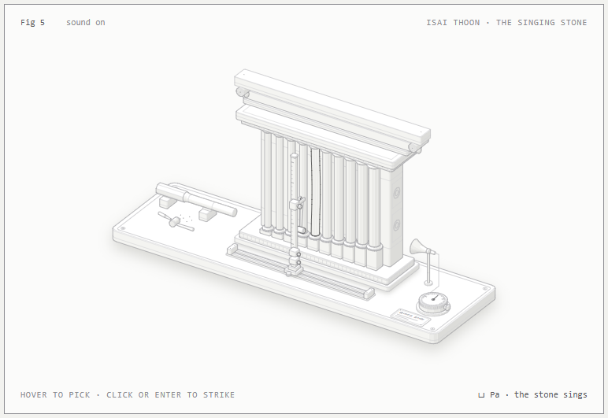

# Udal Koyil · உடல் கோயில்

> உள்ளம் பெருங்கோயில் ஊனுடம்பு ஆலயம்
> *The heart is the great temple; this body of flesh, its shrine.* (Thirumoolar, Thirumanthiram)

Five interactive isometric figures about Tamil tradition and the yogic body, each drawn as a small working machine. Every figure has **two lenses**: what the tradition says, and what anatomy, physics or engineering shows. It isn't meant to debunk or to preach, just to show both models side by side.

**Open the gallery: https://kalicharanhere.github.io/udal-koyil/**

| | Figure | What you can do | Live |
|---|---|---|---|
| 1 | **ஏழு உடல் தாதுக்கள் · Sapta Dhatu** | Food refined pot by pot into seven tissues and ojas, then switch to Anatomy and the blood feeds every tissue at once | [open](https://kalicharanhere.github.io/udal-koyil/dhatu.html) |
| 2 | **ஐந்து வாயுக்கள் · Pancha Vayu** | The five winds and ida, pingala, sushumna as a glowing air tower, against the diaphragm and the nasal cycle | [open](https://kalicharanhere.github.io/udal-koyil/vayu.html) |
| 3 | **ஆறு ஆதாரங்கள் · Chakras** | Seven wheels on one shaft and the bindu rising to the crown, against the glands and nerve plexuses beside the spine | [open](https://kalicharanhere.github.io/udal-koyil/chakra.html) |
| 4 | **கல்லணை · Kallanai** | Karikala Chola's stone weir on the Kaveri as a river sand-table: how stones on sand divide a river for the fields | [open](https://kalicharanhere.github.io/udal-koyil/kallanai.html) |
| 5 | **இசைத் தூண்கள் · Musical Pillars** | Nellaiappar's singing stone: strike a colonette, hear its note, and see why a thicker or shorter stone rings higher | [open](https://kalicharanhere.github.io/udal-koyil/pillars.html) |

Every page has a light version too (`*-light.html`). Each figure lists its sources under the drawing, and numbers marked "about" are approximate. These figures are educational, not medical advice.

Short clips of each figure are in [`videos/`](videos/). The pillars clip has sound.

[](https://kalicharanhere.github.io/udal-koyil/pillars.html)

## How it's built

- Drawn with the open-source [anatomy](https://github.com/wheresryan22/anatomy) skill by Ryan ([@wheresryan22](https://x.com/wheresryan22)), and its biology fork [anima](https://github.com/garinmckayl/anima), using Claude Code.
- `figures/<name>/build.mjs` builds each figure into a standalone HTML page (`--light` for the light theme). `figures/common.mjs` holds the shared lens switch. `node figures/gallery.mjs` assembles the site.
- `docs/` is the published site, served by GitHub Pages.
- `kit/` and `scripts/` are the anatomy/anima drawing kit and its check scripts, kept under their MIT licenses (see [`licenses/`](licenses/)).

```bash
node figures/pillars/build.mjs && node figures/pillars/build.mjs --light
node figures/gallery.mjs
```

## Credits and license

- Drawing kit: © 2026 Ryan (anatomy) and © 2026 Natnael Getenew, Ryan (anima), MIT. Full texts are in [`licenses/`](licenses/).
- Figures, models and text: © 2026 Kali, MIT (see [`LICENSE`](LICENSE)).
- Quoted verse: Thirumoolar's *Thirumanthiram* (public domain).
